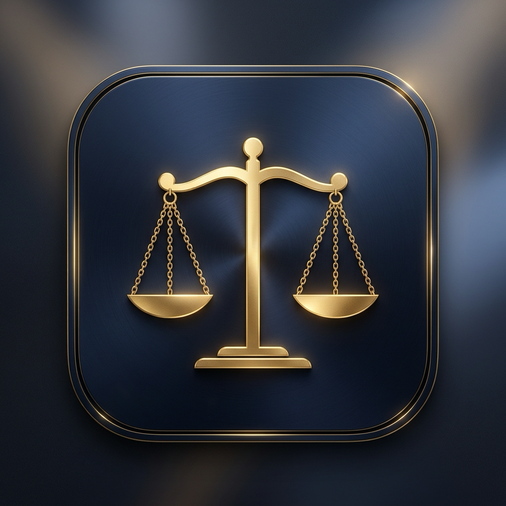

# ⚖️ LexLedger — Hukuk Bürosu Yönetim ve Finans Takip Sistemi

<p align="center">
  
</p>

<p align="center">
  <strong>Avukatlar ve hukuk büroları için modern, hızlı, güvenli ve %100 yerel büro yönetim uygulaması.</strong>
</p>

<p align="center">
  <a href="https://github.com/nmesih/LexLedger/releases/latest"></a>
  
  
  
</p>

---

## 📌 Genel Bakış

**LexLedger**, hukuk bürolarının müvekkil ilişkilerini, dava dosyalarını, duruşma takvimlerini ve finansal akışlarını (vekalet ücretleri, tahsilatlar, masraflar) tek bir modern arayüzden kolayca yönetmelerini sağlayan masaüstü uygulamasıdır.

Tüm verileriniz **kendi bilgisayarınızda yerel olarak (SQLite)** saklanır. Hiçbir buluta veya üçüncü taraf sunucuya veri aktarılmaz. İnternet bağlantınız olmasa bile tam performansla çalışır.

---

## ✨ Temel Özellikler

### 📅 1. UYAP Takvim Entegrasyonu ve Duruşma Takibi
* **Tek Tıkla UYAP Aktarımı:** UYAP Portal'dan indirilen toplu `.ics` takvim dosyalarını saniyeler içinde içeri aktarır.
* **Akıllı Mükerrer Kayıt Filtresi:** Aynı duruşma tekrar yüklendiğinde mükerrer kayıt oluşmasını engeller.
* **Manuel Duruşma Yönetimi:** Harici duruşmaları ve ara kararları elle ekleyebilir, güncelleyebilir veya silebilirsiniz.
* **Zaman Çizelgesi & Hatırlatıcı:** Yaklaşan duruşmaları tarih ve saat sırasına göre listeler.

### 👥 2. Müvekkil ve Dava Dosyası Yönetimi
* **Detaylı Müvekkil Kartları:** İletişim bilgileri, T.C./VKN ve notlar.
* **Dosya Takibi:** Mahkeme adı, dosya/esas numarası, dava türü ve aşama durumu (Açık, Karara Çıktı, Temyiz, Kapandı).
* **Tek Bakışta Durum:** Her müvekkilin aktif davalarını ve finansal bakiyesini aynı ekranda görme.

### 💰 3. Finans, Vekalet Ücreti ve Masraf Takibi
* **Vekalet Ücreti Sözleşmeleri:** Dosya veya müvekkil bazlı ücret anlaşmaları.
* **Parçalı / Taksitli Tahsilat:** Alınan ödemeleri makbuz veya dekont notlarıyla işleme, kalan bakiyeyi anlık hesaplama.
* **Gider & Masraf Kayıtları:** Dava ve büro harcamalarını sınıflandırarak takip etme.

### 👁️ 4. Gizlilik & Maskeleme Modu (Privacy Mode)
* Yanınızda bir müvekkil veya misafir varken finansal durumunuzun görünmesini istemediğiniz anlar için tasarlandı.
* Dashboard, Ücretler ve Raporlar ekranlarındaki toplam tutarlar tek tıkla gizlenir (`•••••• ₺`). İstediğiniz zaman göz ikonuna tıklayarak görünür yapabilirsiniz.

### 📄 5. Profesyonel PDF Raporlama
* Büro finansal özetini, tahsilat oranlarını ve müvekkil bakiyelerini tek tıkla PDF olarak dışa aktarın.
* Tam Türkçe karakter desteği ve yüksek çözünürlüklü şık tasarım.

### ⚙️ 6. Kişiselleştirilebilir Büro Profili
* Ayarlar sayfasından büronuzun adını (`Örn: Alan&Alan Hukuk Bürosu`) özelleştirin; tüm menülerde ve resmi raporlarda kendi unvanınız yer alsın.

---

## 📥 İndir ve Kur

İşletim sisteminize uygun en güncel kurulum dosyasını doğrudan indirebilirsiniz:

| Platform | Kurulum Dosyası | İndir |
| :--- | :--- | :--- |
| 🍏 **macOS (Apple Silicon)** | M1, M2, M3, M4 işlemcili Mac'ler | [LexLedger-1.0.0-arm64.dmg](https://github.com/nmesih/LexLedger/releases/latest/download/LexLedger-1.0.0-arm64.dmg) |
| 🍏 **macOS (Intel)** | Intel işlemcili Mac'ler | [LexLedger-1.0.0.dmg](https://github.com/nmesih/LexLedger/releases/latest/download/LexLedger-1.0.0.dmg) |
| 🪟 **Windows** | Windows 10 & 11 (64-bit) | [LexLedger.Setup.1.0.0.exe](https://github.com/nmesih/LexLedger/releases/latest/download/LexLedger.Setup.1.0.0.exe) |

> ℹ️ Tüm geçmiş ve güncel sürümler için [Releases](https://github.com/nmesih/LexLedger/releases) sayfasını ziyaret edebilirsiniz.

### Kurulum Sırasında İpuçları
* **Mac'te:** `.dmg` dosyasını açıp uygulamayı `Applications` (Uygulamalar) klasörüne sürükleyin. İlk açılışta *"Geliştirici doğrulanamadı"* uyarısı çıkarsa dosyaya `Sağ Tık -> Aç` demeniz yeterlidir.
* **Windows'ta:** İndirilen `.exe` dosyasına çift tıklayarak kurulumu tamamlayın. Windows SmartScreen uyarısı çıkarsa *"Ek Bilgi"*ye tıklayıp *"Yine de Çalıştır"*ı seçin.

---

## 🔒 Güvenlik ve Gizlilik Garantisi

* **Sıfır Bulut Bağımlılığı:** Verileriniz asla internete veya harici sunuculara yüklenmez.
* **Yerel Veritabanı:** Tüm veriler kullanıcının bilgisayarında `better-sqlite3` dosyasında saklanır.
* **Otomatik Yedekleme:** Uygulama her açıldığında veritabanının otomatik yerel yedeğini oluşturur.

---

## 🛠️ Geliştirici Kılavuzu (Development)

Projeyi kendi bilgisayarınızda geliştirmek veya kaynak koddan çalıştırmak için:

### Gereksinimler
* [Node.js](https://nodejs.org/) (v20 veya üzeri)
* `npm`

### Kurulum ve Çalıştırma
```bash
# Depoyu klonlayın
git clone https://github.com/nmesih/LexLedger.git
cd LexLedger

# Bağımlılıkları yükleyin
npm install

# Geliştirme modunda başlatın
npm run dev
```

### Derleme ve Paketleme
```bash
# Projeyi derleyin
npm run build

# Mac için paketleyin (.dmg)
npm run build:mac

# Windows için paketleyin (.exe)
npm run build:win
```

### Kullanılan Teknolojiler
* **Masaüstü Çatısı:** Electron 44 + Electron Vite
* **Arayüz:** React 18, TypeScript, Tailwind CSS
* **Veritabanı:** better-sqlite3
* **İkonlar & Grafikler:** Lucide React, Recharts
* **Raporlama:** jsPDF + jsPDF-AutoTable

---

## 📄 Lisans

Bu proje MIT lisansı ile lisanslanmıştır. Detaylar için `LICENSE` dosyasına bakabilirsiniz.
